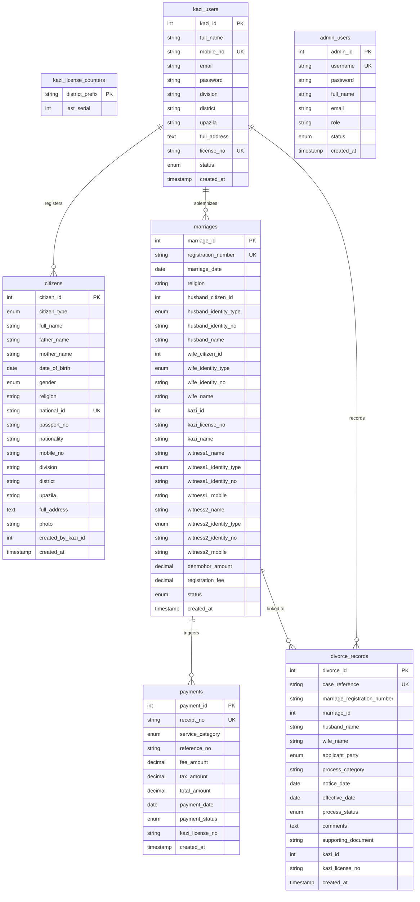
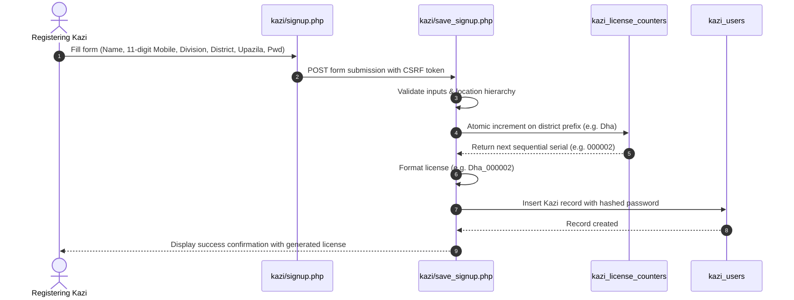
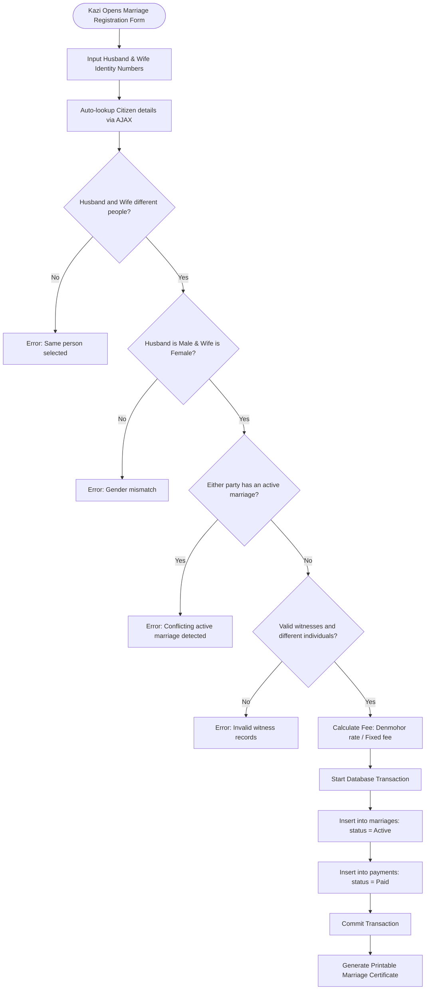

# System Architecture & Database Design
## Marriage Registration & Verification System

### 1. Database Entity-Relationship (ER) Diagram
Target Database: `marriage_project`

---

### 2. Kazi Registration & Auto-License Generation Workflow

---

### 3. Marriage Solemnization & Anti-Conflict Workflow

