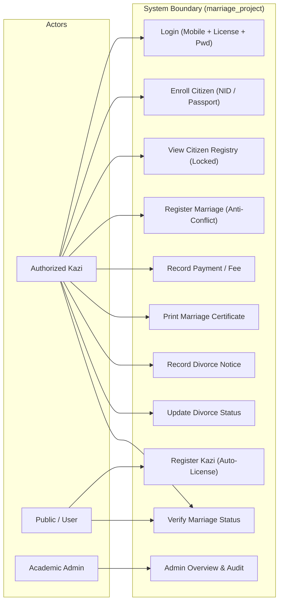
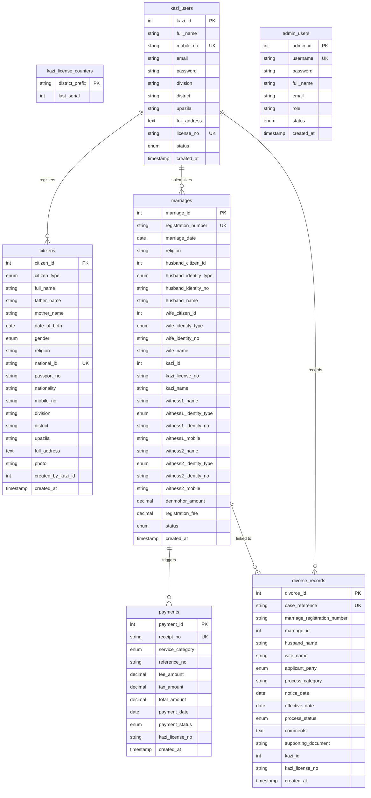

# Marriage Registration and Verification System
## Final Year Academic Project Book & Technical Report

**Project Title:** Marriage Registration and Verification System  
**Developer:** MD SHOJIB AHMED  
**Department:** Computer Science and Engineering (CSE)  
**Academic Year:** 2026  
**Target Environment:** PHP 8.x, MySQL (MariaDB), Apache (XAMPP), Windows  
**Database Identity:** `marriage_project`  

---

## Table of Contents
1. [Chapter 1: Introduction, Problem Statement, and Objectives](#chapter-1-introduction-problem-statement-and-objectives)
2. [Chapter 2: Existing System vs. Proposed System](#chapter-2-existing-system-vs-proposed-system)
3. [Chapter 3: Requirements and Use Cases](#chapter-3-requirements-and-use-cases)
4. [Chapter 4: System Architecture and Database Design](#chapter-4-system-architecture-and-database-design)
5. [Chapter 5: Main Modules and Implementation](#chapter-5-main-modules-and-implementation)
6. [Chapter 6: Testing Approach and Test Cases](#chapter-6-testing-approach-and-test-cases)
7. [Chapter 7: Limitations and Future Enhancements](#chapter-7-limitations-and-future-enhancements)
8. [Chapter 8: Conclusion and References](#chapter-8-conclusion-and-references)

---

## Chapter 1: Introduction, Problem Statement, and Objectives

### 1.1 Introduction
In Bangladesh, Muslim marriages and divorces are governed by statutory and personal laws, notably the Muslim Marriages and Divorces (Registration) Act of 1974 and the Muslim Family Laws Ordinance of 1961. Historically, marriage solemnization and record maintenance have been conducted manually by authorized Marriage Registrars (Kazis) utilizing physical ledger books (Bahi / Nikah Nama).

This project presents a web-based academic prototype of a **Marriage Registration and Verification System**. It is developed as an educational prototype for demonstration, testing, and evaluation under the Bachelor of Science in Computer Science and Engineering curriculum.

### 1.2 Problem Statement
The conventional paper-based marriage registration process suffers from critical structural vulnerabilities:
1. **Underage and Child Marriages:** Inability to reliably enforce statutory age limits (21 for males, 18 for females) in the absence of centralized record validation.
2. **Polygamy and Conflicting Marriages:** Lack of real-time multi-jurisdiction checks allows individuals to enter into concurrent active marriages undetected across different upazilas or districts.
3. **Identity Verification Deficits:** Traditional paper Nikah Nama records lack tamper-evident digital verification, making it difficult for public authorities, banks, and foreign embassies to verify validity.
4. **Foreign Citizen Handling:** Inadequate standardized workflows for marriages involving foreign nationals holding passports rather than Bangladeshi National IDs.
5. **Divorce Tracking Gaps:** Paper-based notice tracking often fails to distinguish between an initial filed notice and a legally confirmed dissolution decree.

### 1.3 Project Objectives
The primary objectives of this academic prototype are:
- To implement an automated Kazi registration system that dynamically generates standardized district-coded license identifiers (e.g., `Dha_000001`, `Chu_000001`).
- To provide citizen enrollment supporting both Bangladeshi citizens (NID-based) and foreign nationals (Passport-based) with strict immutability rules.
- To enforce algorithmic marriage eligibility checks, including spouse distinction, gender rules, and concurrent active marriage prevention.
- To implement a configurable fee calculation module based on Denmohor (for Muslim marriages) and fixed fees (for Hindu marriages and divorce services).
- To generate a clean, academic certificate-style document with browser printing and PDF generation support.
- To introduce a structured divorce module tracking notice filing, arbitration stages, and final decrees without assuming automated legal outcomes.

---

## Chapter 2: Existing System vs. Proposed System

### 2.1 The Existing Manual System
In the existing manual setup:
- A Kazi manually records entries into physical Nikah Nama volumes.
- Citizens must physically produce photocopies of NIDs, birth certificates, or affidavits.
- Serial numbers are handwritten and prone to human error, duplications, or post-dated entries.
- Verification requires contacting the physical chamber or searching manual district archives.

### 2.2 The Proposed Digital Prototype
The proposed prototype introduces:
- **Centralized Database:** A single target database (`marriage_project`) with relational tables and atomic transactions.
- **Automated License Generation:** Concurrent-safe license numbering based on district prefixes.
- **Role-Based Authorization:** Secure session isolation for registered Kazis and administrators.
- **Dual Identity Handling:** Distinct workflows for Bangladeshi NIDs and foreign passports.
- **Formal Certificate Generation:** Clean, printable documents with clear academic disclaimers.

---

## Chapter 3: Requirements and Use Cases

### 3.1 Functional Requirements
- **FR-01: Kazi Self-Registration:** Allows a Kazi to register by providing full name, 11-digit mobile number, email, address, and verified administrative division, district, and upazila.
- **FR-02: Auto-License Assignment:** The system generates a district-coded unique license (e.g. `Dha_000001`) during registration without user manipulation.
- **FR-03: Kazi Authentication:** Login requiring mobile number, license number, and password with secure `password_verify()` verification.
- **FR-04: Citizen Enrollment:** Allows Kazis to enroll citizens. Records become immutable once saved.
- **FR-05: Foreign Citizen Workflow:** Allows passport-based enrollment without requiring a Bangladeshi NID.
- **FR-06: Marriage Solemnization:** Automatically retrieves citizen records, performs spouse disparity and gender checks, prevents active conflicts, and computes proposed fees.
- **FR-07: Payment Tracking:** Generates unique receipt references and logs fee breakdowns.
- **FR-08: Authorized Search:** Restricts detailed marriage status lookup to authenticated Kazis.
- **FR-09: Divorce Procedure Tracking:** Records notice submissions, applicant parties, arbitration notes, and status updates.

### 3.2 Non-Functional Requirements
- **Security:** CSRF tokens on all state-changing forms, parameterized SQL statements (`mysqli_prepare`), output escaping (`htmlspecialchars`), and bcrypt password hashing.
- **Data Integrity:** Database transactions (`mysqli_begin_transaction`) to prevent partial or corrupted records.
- **Portability:** Operates smoothly on standard Windows/XAMPP environments without external paid APIs.

### 3.3 Use Case Diagram

---

## Chapter 4: System Architecture and Database Design

### 4.1 System Architecture
The application follows a structured three-tier architecture:
1. **Presentation Layer:** HTML5, CSS3, JavaScript (ES6), Bootstrap 5.3, and FontAwesome 6 icons.
2. **Application / Business Logic Layer:** PHP 8.x procedural architecture with modular configuration helpers (`config/bangladesh_geo.php`, `config/fees.php`, `includes/security.php`).
3. **Data Layer:** MySQL / MariaDB on XAMPP (target database: `marriage_project`) using InnoDB storage engine.

### 4.2 Entity-Relationship (ER) Diagram

---

## Chapter 5: Main Modules and Implementation

### 5.1 Kazi Module (`kazi/`)
- **Auto-Generated License Engine:** When a Kazi submits registration in `kazi/signup.php`, the district prefix is extracted (e.g., `Dhaka` -> `Dha`, `Chuadanga` -> `Chu`). Inside an atomic transaction with `SELECT ... FOR UPDATE`, the district's counter in `kazi_license_counters` is incremented, and the license number `Prefix_000000` is generated.
- **Three-Factor Login:** Requires registered 11-digit mobile number, generated license number, and password.
- **Kazi Dashboard (`kazi/dashboard.php`):** Displays chamber information, marriage and divorce counters, quick links, and recent transaction tables.

### 5.2 Citizen Management (`citizen/`)
- **Bangladeshi vs Foreign Citizen Handling:**
  - Bangladeshi workflow: requires National ID (NID), exactly 11-digit mobile number, verified administrative division/district/upazila, and optional photograph.
  - Foreign national workflow: requires Passport Number, Nationality, and residential contact without demanding a Bangladeshi NID.
- **Immutability Protection:** Citizen editing and deletion functionality has been disabled. The citizen list (`view_citizens.php`) marks records as `Locked` to prevent post-registration tampering.

### 5.3 Marriage Registration (`kazi/marriage_registration.php`)
- **Real-Time Citizen Retrieval:** Queries `api/lookup_citizen.php` via AJAX when an identity number is entered.
- **Integrity Constraints:**
  - Husband and Wife cannot have identical identity numbers.
  - Husband must be registered as Male; Wife must be registered as Female.
  - Neither spouse can have an existing record with `status = 'Active'`.
  - Witnesses cannot be either spouse, and Witness 1 != Witness 2.
- **Auto-Registration & Receipt Numbering:** Automatically generates numbers like `MR-2026-XXXXXX` and `RCT-2026-XXXXXX` inside a transaction.

### 5.4 Fee Calculation Module (`config/fees.php`)
- **Muslim Marriage Registration:** Calculated dynamically at the proposed rate of **৳14 per ৳1,000 (or part thereof) of Denmohor** (with a minimum proposed filing fee of ৳200.00).
- **Hindu Marriage Registration:** Fixed proposed academic fee of **৳1,000.00**.
- **Divorce Proceedings:** Fixed proposed service fee of **৳1,000.00**.
- **Tax Policy:** Defaulted to 0.00% tax. Unverified official tax rates are not invented.

### 5.5 Printable Marriage Certificate (`Certificate/view_certificate.php`)
- Displays formal Heading: **Marriage Registration Certificate**.
- Displays registration number, date, husband and wife details, Kazi details, witnesses, Denmohor amount, and status.
- Includes three signature blocks: **Husband**, **Wife**, and **Kazi**.
- Includes browser printing styles (`@media print`) and an academic disclaimer watermark.

### 5.6 Divorce Module (`divorce/`)
- Allows Kazis to record notices under section 7 of MFLO, mutual consent (Khula), or court decrees.
- Procedural statuses: `Notice Recorded`, `In Reconciliation`, `Completed / Effective`, `Withdrawn`.
- Safe document upload accepting PDF, JPG, and PNG with size limits and randomized filenames.
- Printable summary document (`divorce/view.php`) and status update mechanism (`divorce/update_status.php`).

---

## Chapter 6: Testing Approach and Test Cases

### 6.1 Testing Methodology
Manual functional testing was performed locally on Windows with XAMPP (Apache and MySQL). Test cases evaluate validation rules, identity constraints, database transactions, and certificate printing.

### 6.2 Test Cases and Results

| Test ID | Test Description | Input Data | Expected Result | Result |
| :--- | :--- | :--- | :--- | :--- |
| **TC-01** | Kazi Registration Auto-License | Division: Dhaka, District: Dhaka, Upazila: Dhanmondi, Mobile: 01711000222 | License auto-generated formatted as `Dha_00000X`. User cannot type license. | Passed |
| **TC-02** | Mobile Number Validation | Mobile: `01712345` (8 digits) | Rejected with error: Mobile number must contain exactly 11 digits. | Passed |
| **TC-03** | Location Hierarchy Validation | Division: Sylhet, District: Dhaka | Rejected: District does not belong to selected division. | Passed |
| **TC-04** | Kazi Three-Factor Login | Mobile: `01711000111`, License: `Dha_000001`, Password: `password123` | Successful login; redirected to `kazi/dashboard.php`. | Passed |
| **TC-05** | Bangladeshi Citizen NID Duplicate Check | NID: `19982690011223344` (existing) | Rejected: Citizen with National ID already registered. | Passed |
| **TC-06** | Foreign Citizen Enrollment | Type: Foreign, Passport: `B98765432`, Nationality: `Canadian` | Successfully saved without requiring Bangladeshi NID. | Passed |
| **TC-07** | Citizen Immutability Check | Access `citizen/edit_citizen.php` | Page displays locked warning: Modification disabled by project rules. | Passed |
| **TC-08** | Marriage Same-Person Check | Husband NID: `19982690011223344`, Wife NID: `19982690011223344` | Rejected: Husband and Wife cannot have identical identity numbers. | Passed |
| **TC-09** | Conflicting Active Marriage Check | Husband NID: `19982690011223344` (already active in MR-2026-000001) | Rejected: Husband already has an existing active marriage registration. | Passed |
| **TC-10** | Denmohor Fee Calculation (Muslim) | Denmohor: ৳500,000 | Fee calculated as (500 units * ৳14) = ৳7,000.00; payment receipt logged. | Passed |
| **TC-11** | Divorce Notice Recording | Linked Reg: `MR-2026-000001`, Status: `Notice Recorded` | Saved as notice; marriage marked as `Divorce Initiated` (not dissolved). | Passed |
| **TC-12** | Certificate Browser Printing | Click "Print / Save as PDF" in certificate | Browser print dialog opens with clean layout without UI buttons. | Passed |

---

## Chapter 7: Limitations and Future Enhancements

### 7.1 Known Limitations
1. **Academic Demonstration Only:** The application operates on local synthetic testing data and does not interface with the national election commission's NID database or immigration systems.
2. **Personal Law Nuances:** While Muslim, Hindu, and special marriage categories are recognized, non-Muslim divorce proceedings vary under different statutory enactments (e.g., Special Marriage Act 1872 vs Hindu personal law traditions) and are represented as preliminary procedural logs.
3. **Fee Rate Verification:** Proposed fee calculations (৳14/৳1000 for Muslim marriage; ৳1,000 for Hindu marriage and divorce) are academic models subject to official statutory verification.

### 7.2 Future Scope (Admin Enhancements)
In alignment with the project requirements, the following complex administrator features are earmarked as future scope:
- Full administrative license revocation and disciplinary hearings for registrars.
- Automated API integrations with National Identity Card (EC-NID) and Immigration/Passport databases.
- Multi-tier arbitration council hearing logs and judicial summons tracking.
- Automated SMS notifications to parties upon notice recording.

---

## Chapter 8: Conclusion and References

### 8.1 Conclusion
The **Marriage Registration and Verification System** successfully models a structured, secure, and beginner-friendly web application for digital marriage management. By replacing manual paperwork with automated district-based license generation, strict citizen immutability, Denmohor-based fee schedules, anti-polygamy safeguards, and structured divorce tracking, the prototype demonstrates how software engineering principles can improve civil record-keeping.

### 8.2 Academic References
1. Muslim Marriages and Divorces (Registration) Act, 1974 (Act No. LII of 1974).
2. Muslim Family Laws Ordinance, 1961 (Ordinance No. VIII of 1961).
3. The Child Marriage Restraint Act, 2017 (Act No. VI of 2017).
4. PHP Documentation Group, *PHP 8.x Reference Manual*, 2024.
5. Oracle Corporation, *MySQL 8.0 Reference Manual*, 2024.
